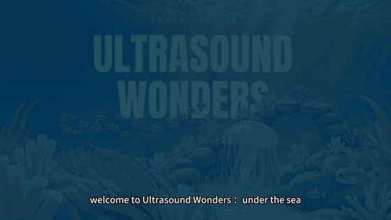

# Ultrasound Wonders: Under the Sea 🪸

**Real scan moments, made meaningful.** An AR → VR → AR calming experience for children during ultrasound exams, built for Meta Quest 3.

面向**超声检查中的儿童患者**的情绪安抚体验。孩子躺在病床上戴着 Quest 3,在故事里变成海底的一株珊瑚:小鱼游来、海草随着探头轻抚身体、水母陪着一起呼吸——用一段温柔的海底故事陪伴整个检查过程。

## 🎬 Demo

[](https://github.com/Lin-Murphy/UnderTheSea/releases/download/v0.1-cs15/Ultrasound-Wonders-Demo.mp4)

▶️ **[观看完整演示视频 / Watch the full demo (MP4, 56 s)](https://github.com/Lin-Murphy/UnderTheSea/releases/download/v0.1-cs15/Ultrasound-Wonders-Demo.mp4)** · 📦 **[下载 Quest 3 APK](https://github.com/Lin-Murphy/UnderTheSea/releases/tag/v0.1-cs15)**

## 👥 制作人 / Team

**Team 2 — Ultrasound Wonders**

- Renee Wen
- Murphy Lin
- Kevin Zheng
- Haoxin Liang

---

## 💡 设计理念 / The Idea

### The room: one scan, three roles, one story

一次儿童超声检查里,有三件让孩子觉得难受的小事:

| | 难点 / What feels hard |
|---|---|
| 01 | **冰凉的耦合剂** — Cool gel |
| 02 | **探头的按压** — Probe pressure |
| 03 | **呼吸指令**(吸气、憋气)— Breathing instructions |

### Every sensation becomes a story

| 检查中的真实感受 | 在海底故事里变成 |
|---|---|
| 涂耦合剂 Gel | 一群小鱼游来,轻触你这株珊瑚 |
| 探头接触 Probe contact | 海草和小丑鱼依偎、追随着探头 |
| 患者的呼吸 Patient's breath | 吸气憋气时水母变大、珊瑚发光、整个世界变亮;正常呼气时水母缩小 |

### Human-operated, built together

**连接检查与大海的是人,而不是传感器。** 医生主导检查并发出呼吸指令;助手根据医生的提示操作 VR 世界;患者戴着头显,自己的动作会得到回应。**患者不是旁观者,而是主动的参与者**——医生、助手和患者一起完成这个故事。

> English summary: The child lies on the exam bed wearing only a Quest 3 headset (no controllers) and becomes a coral on the sea floor. The sonographer's probe carries an AprilTag; soft seaweed and a clownfish follow it on the child's "body". An assistant holds the right controller to advance scenes and guide breath-holding. Everything runs in one Unity scene through a state machine.

## ✨ 体验流程

参与者有三个角色:

| 角色 | 做什么 |
|---|---|
| **患者** | 只戴 Quest 3 头显,第一人称视角,低头能看到"自己"——一株珊瑚 |
| **医生** | 操作超声探头,探头上贴一张 AprilTag(ID 1) |
| **医生助手** | 拿右手柄切换场景、引导呼吸 |

| 阶段 | 内容 |
|---|---|
| **Standby** | 现实(Passthrough),面前一个 Start 按钮 |
| **1 Enter** | 沙丁鱼风暴从四面八方螺旋游来,海底从近到远长出来 |
| **2 涂耦合剂** | 小鱼游进"我"(珊瑚)身体的空隙里躲着 |
| **3 探头检查** | 柔软海草随浪抚摸身体,**跟随探头上的 AprilTag**,有按压感;小丑鱼在海草间游动、追着探头 |
| **天黑过渡** | 天色变暗,水母一上一下游来,小鱼躲进珊瑚,一条大鱼缓慢巡游 |
| **4 憋气** | 助手**按住扳机** = 吸气/憋气:珊瑚变大、海草螺旋包裹、水母放大并发光,画面中出现 "Hold";**松开** = 呼气,3 秒恢复。可以反复 |
| **天亮过渡** | 天亮,水母游走消失 |
| **Exit** | 鱼群聚拢,海底退去,回到现实 |

全程配有环境音效与英文旁白(VO)。

## 🎮 操作

| 输入 | 作用 |
|---|---|
| 右手柄 **A** / 空格 / 点击 Start 按钮 | 开始 / 下一阶段 |
| 右手柄 **B** / 键盘 B 或 R | 随时回到 Start(现实) |
| 右手柄 **扳机按住** / 键盘 **F** | 场景 4 吸气憋气,松开 = 呼气 |
| Backspace | 上一阶段(调试) |
| 鼠标 左键 / 右键 / 中键 | 编辑器中模拟 Tag 1 / 0 / 2 |
| Alt + 左键拖动、Home | 编辑器中转头、复位 |
| T | 开关 tag 位置测试点 |

## 🛠 环境要求

- **Unity 6000.3.27f2**(Unity 6.3)
- URP 17.3.0 — 管线资源 `Assets/Settings/UnderTheSea/Quest_URP.asset`,**HDR 关闭**(否则 Passthrough 会蒙一层蓝)
- Meta XR SDK (all) 207.0.1、OpenXR 1.19.0、Input System(Active Input Handling = Both)
- 构建目标 Android,设备 **Meta Quest 3**
- 一张打印的 AprilTag(**tagStandard41h12**,ID 1),含白边 5×5 cm,打印页在 [`Documentation/AprilTag/`](Documentation/AprilTag/)

## 🚀 快速开始

1. 用 Unity Hub 以 **6000.3.27f2** 打开本项目(首次导入 Meta XR SDK 需要一些时间)。
2. 打开 `Assets/Scenes/Main.unity`。
3. **编辑器内预览**:点 Play。连着 Quest Link 时头显和 Game 视图同步;没有头显时自动退回桌面预览(`XRLinkFallback`)。可在菜单 `UnderTheSea > XR > Play In Headset (Quest Link)` 切换。
4. **构建到 Quest**:File > Build Profiles 选 Android,构建 `Main.unity`,然后:

   ```bash
   adb install -r Builds/UnderTheSea.apk
   ```

   首次运行需授予头显摄像头权限(`horizonos.permission.HEADSET_CAMERA`,用于 AprilTag 识别)。
   **注意:** 在 Quest 上测试前请先关闭 Quest Link,否则回到应用后可能没有声音。

### 重新生成主场景

`Main.unity` 由脚本生成:菜单 `UnderTheSea > Migration > Build Main With Imported Reef Art`([`Assets/Editor/BuildReefMainScene.cs`](Assets/Editor/BuildReefMainScene.cs))。它以 `UnderwaterExamPreview.unity` 的美术为底,加上交互、音效和配音后保存 Main,并做静态检查。**直接手改 Main 会在下次重建时被覆盖,改动请写进 Builder。**

### 自检工具

- `UnderTheSea > AprilTag > Self Test (synthetic frame)` — 不用头显检查 AprilTag 识别链路
- `UnderTheSea > Migration > Run Complete Flow Smoke Check` — Play 模式下跑一遍完整流程

## 🧩 项目结构

```
Assets/
  Scenes/Main.unity           唯一的运行场景
  Scripts/                    运行时脚本
  Editor/                     场景生成器、自检、编辑器工具
  Shaders/                    海草、海平面、呼吸粒子、Hold 字幕等
  UltrasoundReef/             海底美术(珊瑚、水母、海葵、鱼)
  Models/Clownfish/           小丑鱼模型与动画
  Audio/  Audio/VO/           音效与旁白
Packages/jp.keijiro.apriltag  内嵌的 AprilTag 检测包(含标定内参改动)
Documentation/                开发记录、AprilTag 打印页
```

| 主要脚本 | 作用 |
|---|---|
| `ExperienceController` | 状态机、呼吸值 |
| `KeyboardStageInput` / `XRControllerStageInput` | 键盘 / 右手柄输入 |
| `OceanStageView` | 总表现层:AR↔VR 显现、天黑、主角珊瑚、转场鱼群 |
| `ReefArtDriver` | 水母游动、发光、夜色灯光 |
| `ReefFishSchool` | 鱼群游动、躲进珊瑚、天敌 |
| `SoftSeaweedStrands` | 24 根 Verlet 软体海草:抚摸、按压、包裹 |
| `TagClownfish` | 跟随探头的小丑鱼 |
| `BreathGlow` / `BreathGuide` | 憋气时的发光粒子 / 呼吸引导与 "Hold" 字幕 |
| `ReefSoundscape` / `ReefVoiceOver` / `AudioGain` | 音效、旁白、增益与软限幅 |
| `QuestAprilTagPoseSource` / `CompositeTagPoseSource` / `MockTagPoseSource` | AprilTag 位姿(真机检测优先,编辑器鼠标模拟兜底) |
| `PassthroughBridge` / `XRLinkFallback` | Passthrough、编辑器 XR 兜底 |

### AprilTag 识别链路

`PassthroughCameraAccess`(左相机)→ `jp.keijiro.apriltag` → `QuestAprilTagPoseSource`(只在探头阶段检测,10 Hz)→ `CompositeTagPoseSource`。目前只使用 **ID 1(探头)**。

## 🚧 已知限制

- 真机上 AprilTag 识别与海草跟随仍在验证中。
- 尚未做患者躺姿下"真实肚子 ↔ 虚拟珊瑚"的标定;tag 位置目前被限制在珊瑚身体周围的圆柱区域内。
- 这是一个研究 / 原型项目,**不是医疗器械**,未经过临床验证。

## 🔭 下一步 / Next Chapter

- **Move with the story** — 把"侧身""放松肚子"等更多检查指令变成故事里的动作。
- **Prepare through play** — 需要时把"喝水"等检查前准备也融入游戏。
- **Respond to every breath** — 希望能自动检测呼吸,让海底世界直接回应患者。

我们希望把更多检查指令都变成故事里好玩的时刻。

## 🤝 贡献

欢迎 Issue 和 Pull Request。较大的改动请先开 Issue 讨论。修改主场景时请改 `BuildReefMainScene.cs`,而不是直接改 `Main.unity`。

## 📄 许可证

本项目的**源代码**以 [MIT License](LICENSE) 开源,© 2026 Renee Wen, Murphy Lin, Kevin Zheng, Haoxin Liang(Team 2 — Ultrasound Wonders)。

第三方组件遵循各自的许可证:

| 组件 | 许可证 |
|---|---|
| [`Packages/jp.keijiro.apriltag`](Packages/jp.keijiro.apriltag)(Keijiro Takahashi,基于 University of Michigan 的 AprilTag) | BSD 2-Clause,见包内 `LICENSE` |
| Meta XR SDK、Unity 各软件包 | 各自的许可条款(通过 Package Manager 获取,不包含在本仓库) |

美术(模型、贴图、材质)、音效与配音素材的版权归各自作者所有,如需在本项目之外使用请先联系作者。
